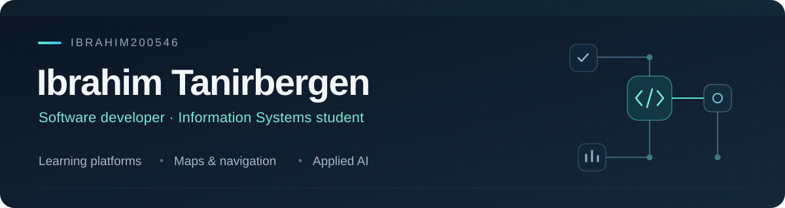

  

  <a href="https://github.com/Ibrahim200546/Ibrahim200546/blob/main/README.md">English</a> ·
  <strong>Русский</strong> ·
  <a href="https://github.com/Ibrahim200546/Ibrahim200546/blob/main/profile/README.kk.md">Қазақша</a>

## Обо мне

Меня зовут **Тәңірберген Ибраһим Мұхтарұлы**. Я студент специальности **«Информационные системы»** из **Талдыкоргана, Казахстан**. Разрабатываю веб-приложения и изучаю, как применять ИИ, данные и интерактивные интерфейсы в обучении и повседневных задачах.

Среди моих проектов — приложения для инклюзивного обучения, навигация по кампусу и прототип мониторинга транспорта. Развиваю навыки **промпт-инжиниринга, AI/ML, работы с базами данных и аналитики данных** через практические проекты и учёбу.

## Избранные проекты

<table>
  <tr>
    <td width="50%" valign="top">
      <h3><a href="https://github.com/Ibrahim200546/inclusiveapp">InclusiveApp / Edu CoreX</a></h3>
      
<strong>Инклюзивное обучение · Командный проект</strong>

      
Интерактивные аудиозадания и речевые упражнения для детей. Интегрирована предобученная модель распознавания фонем.

      
<code>React</code> <code>TypeScript</code> <code>Vite</code> <code>Supabase</code> <code>ONNX</code>

      
<a href="https://github.com/Ibrahim200546/inclusiveapp">Открыть проект →</a>

    </td>
    <td width="50%" valign="top">
      <h3><a href="https://github.com/Ibrahim200546/unimap">UniMap</a></h3>
      
<strong>Навигация по кампусу</strong>

      
Карты кампуса, поиск аудиторий и маршруты внутри зданий. Интерфейс на казахском, русском и английском языках.

      
<code>Next.js</code> <code>TypeScript</code> <code>Leaflet</code> <code>Supabase</code>

      
<a href="https://github.com/Ibrahim200546/unimap">Открыть проект →</a>

    </td>
  </tr>
  <tr>
    <td width="50%" valign="top">
      <h3><a href="https://github.com/Ibrahim200546/smartfleet">SmartFleet</a></h3>
      
<strong>Мониторинг транспорта · Прототип</strong>

      
Карта, данные автомобилей и трекеров, сервер на FastAPI и приём телеметрии Teltonika. Предусмотрен демонстрационный режим.

      
<code>Next.js</code> <code>Python</code> <code>FastAPI</code> <code>SQLAlchemy</code>

      
<a href="https://github.com/Ibrahim200546/smartfleet">Открыть проект →</a>

    </td>
    <td width="50%" valign="top">
      <h3><a href="https://github.com/Ibrahim200546/stepupkz">StepUp Shoes</a></h3>
      
<strong>Интернет-магазин · Учебный проект</strong>

      
Каталог товаров, корзина, панель администратора и обмен сообщениями в реальном времени. Поддерживаются три языка интерфейса.

      
<code>React</code> <code>TypeScript</code> <code>Vite</code> <code>Supabase</code>

      
<a href="https://github.com/Ibrahim200546/stepupkz">Открыть проект →</a>

    </td>
  </tr>
</table>

## Достижения и участие

### Лучший социальный стартап — STARTUP ZHETYSU 2026

Участник команды **InclusiveApp**, получившей награду в категории **«Үздік әлеуметтік стартап»**. В публикации университета я указан среди авторов проекта.

[Публикация университета →](https://zhetysu.edu.kz/265211-2/)

### HackAlem AI — Астана, сентябрь 2026

Участвовал в составе **ZhetysuTech** в треке «Энергетика»: прогнозирование выработки ветроэлектростанции на **24–48 часов**. Университет сообщил об участии нашей команды в мероприятии 23 сентября 2026 года.

[Публикация университета →](https://zhetysu.edu.kz/2026/09/24/students-of-zhetysu-university-became-part-of-the-guinness-world-records-record/) · [Сертификат участника · выдан 18 октября 2026](https://edu.astanahub.com/hackathons/df4743f5-c492-415c-b45a-1f13adb78e06/tracks/06d09878-1838-4118-acb0-37573709bac8/certificate/CERT-20261018-715C8865) · [Источники о достижениях →](https://github.com/Ibrahim200546/Ibrahim200546/blob/main/profile/ACHIEVEMENTS.md)

## Технологии и обучение

| Направление | Технологии и интересы |
| :--- | :--- |
| Веб-разработка | TypeScript, JavaScript, React, Next.js, Vite, Tailwind CSS |
| Серверная часть и данные | Python, FastAPI, Supabase, PostgreSQL, SQLAlchemy |
| Прикладной ИИ | Промпт-инжиниринг, интеграция предобученных моделей, ONNX; изучение ML и аналитики данных |
| Инструменты | Git, GitHub, VS Code, Android Studio |
| Продолжаю изучать | Java, Dart, Flutter; участие в обучении AI-SANA |

## Образование

**Жетысуский университет имени Ильяса Жансугурова**  
Информационные системы · 3-й курс · 2024 — настоящее время  
Общий GPA: **3,54 / 4,00**

**Талдыкорганский высший политехнический колледж**  
Техник мультимедийных и цифровых систем

**Языки:** казахский — родной · русский — свободное общение · английский — рабочие знания, по самооценке

---

  <a href="https://github.com/Ibrahim200546">GitHub</a> ·
  <a href="https://github.com/Ibrahim200546?tab=repositories">Все репозитории</a>
   
  Талдыкорган, Казахстан · Учусь, создавая полезные приложения

